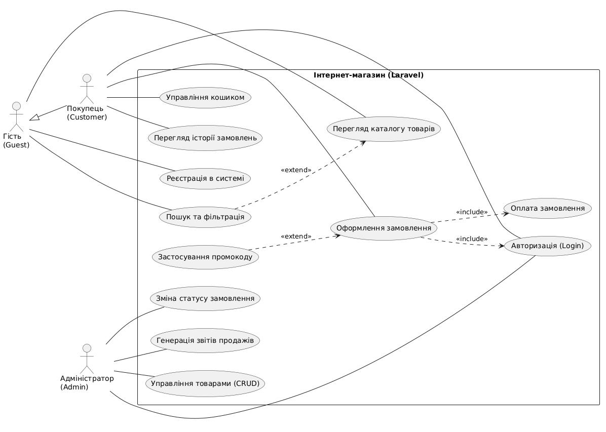
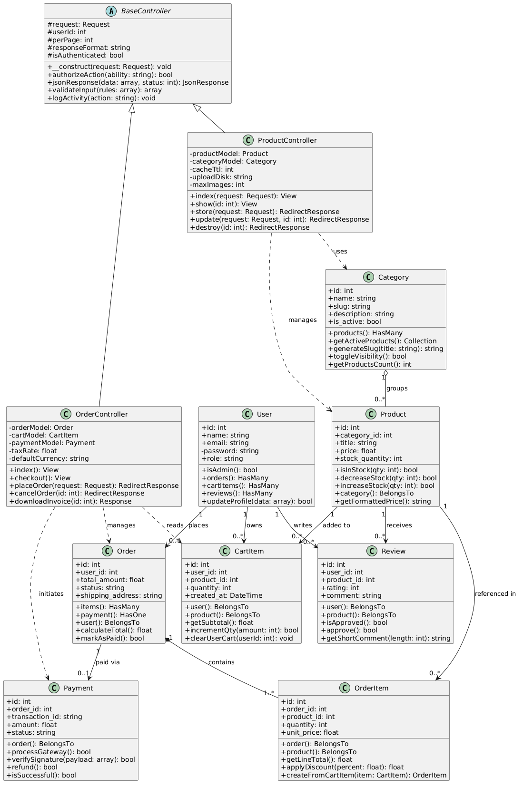

# Архітектура та проєктування системи: Інтернет-магазин (Варіант 7)

## 1. Аналіз предметної галузі

### Призначення ПЗ та основні функції
Веб-застосунок призначений для автоматизації онлайн-продажу товарів, управління каталогом, обробки замовлень клієнтів та аналітики продажів.
1. Реєстрація, автентифікація та управління профілем користувача.
2. Перегляд каталогу товарів із фільтрацією за категоріями, ціною та пошуком.
3. Управління кошиком покупок (додавання, зміна кількості, видалення позицій).
4. Оформлення замовлення з вибором способу доставки та оплати (онлайн або післяплата).
5. Управління каталогом товарів, категоріями та залишками на складі (CRUD для адміністратора).
6. Зміна статусів замовлень та формування фінансової звітності.

### Користувачі системи
* **Гість (Guest)** — неавторизований відвідувач (перегляд каталогу, пошук, реєстрація).
* **Покупець (Customer)** — авторизований користувач (робота з кошиком, оформлення замовлень, перегляд історії, залишення відгуків).
* **Адміністратор (Admin)** — менеджер магазину (управління товарами, категоріями, замовленнями, перегляд звітів).

### Архітектура системи
Застосунок будується на базі фреймворку **Laravel** за архітектурним патерном **MVC (Model-View-Controller)**:
* **Model (Eloquent ORM):** інкапсулює бізнес-логіку та взаємодію з реляційною БД.
* **View (Blade Templates):** відповідає за відображення інтерфейсу користувача.
* **Controller:** приймає HTTP-запити, валідує вхідні дані, викликає методи моделей та повертає відповідь.

### Основні сценарії роботи
1. Реєстрація нового покупця та вхід у систему.
2. Пошук товару, додавання до кошика та оформлення замовлення з онлайн-оплатою.
3. Додавання нового товару адміністратором та оновлення статусу замовлення клієнта.

### Основні логічні сутності та таблиці БД
* `User` — таблиця `users` (користувачі системи та їхні ролі).
* `Category` — таблиця `categories` (категорії товарів).
* `Product` — таблиця `products` (товари, ціни, опис, залишки).
* `CartItem` — таблиця `cart_items` (позиції поточного кошика користувача).
* `Order` — таблиця `orders` (заголовки замовлень, статуси, адреси).
* `OrderItem` — таблиця `order_items` (конкретні товари в оформленому замовленні).
* `Payment` — таблиця `payments` (транзакції оплати замовлень).

### Вихідні дані (Output)
* **Таблиці:** інтерактивна таблиця активних замовлень в адмін-панелі; таблиця історії замовлень покупця.
* **Звіти:** фінансовий звіт про продажі за обраний період (експорт у CSV/PDF); товарна накладна (чек) замовлення.
* **Графіки:** стовпчикова діаграма динаміки виручки за місяцями; кругова діаграма частки продажів за категоріями товарів.

---

## 2. Опис головного Use Case (Повна форма)

* **Назва:** Оформлення та оплата замовлення (Checkout).
* **Головний актор:** Покупець (Customer).
* **Зацікавлені особи:** Покупець (хоче швидко отримати товар), Адміністратор (хоче отримати коректне замовлення та оплату).
* **Передумови:** Покупець авторизований у системі; у кошику є щонайменше 1 товар.
* **Постумови:** Створено запис замовлення в БД, зменшено залишки товарів на складі, кошик очищено, ініційовано платіж.

### Головний успішний сценарій
1. Покупець переходить на сторінку кошика та натискає кнопку «Оформити замовлення».
2. Система перевіряє актуальну наявність усіх товарів із кошика на складі.
3. Система відображає форму оформлення замовлення з підсумковою вартістю.
4. Покупець вводить контактні дані (ПІБ, телефон) та обирає спосіб і адресу доставки.
5. Покупець обирає спосіб оплати («Онлайн-оплата карткою»).
6. Покупець підтверджує замовлення, натискаючи «Підтвердити та оплатити».
7. Система створює нове замовлення в БД зі статусом `pending` та резервує товари на складі.
8. Система перенаправляє Покупця на платіжний шлюз для проведення транзакції.
9. Платіжний шлюз підтверджує успішне списання коштів; система змінює статус замовлення на `paid` та створює запис у таблиці платежів.
10. Система очищує кошик Покупця, формує електронний чек та відображає сторінку успішного замовлення.

### Альтернативні сценарії
* **2а. Товару недостатньо на складі:** Система блокує перехід до оформлення, виділяє проблемну позицію червоним та пропонує зменшити кількість до доступного залишку.
* **4а. Некоректно заповнені поля доставки:** Після спроби відправки форми Laravel-валідатор повертає Покупця на форму з підсвічуванням помилок.
* **5а. Обрано оплату при отриманні (післяплата):** Кроки 8–9 пропускаються; замовлення одразу отримує статус `confirmed`, кошик очищується, система переходить до кроку 10.
* **9а. Помилка оплати або відхилення картки банком:** Платіжний шлюз повертає помилку. Замовлення залишається в статусі `payment_failed`, резерв товарів знімається, система пропонує повторити спробу оплати в особистому кабінеті.
* **9б. Користувач закрив вікно оплати (тайм-аут):** Замовлення зберігається у статусі `pending` протягом 30 хвилин, після чого фонове завдання автоматично скасовує замовлення та повертає товари на склад.

---

## 3. UML-діаграми проєктування

### Діаграма варіантів використання (Use Case Diagram)

### Діаграма класів (Class Diagram)

